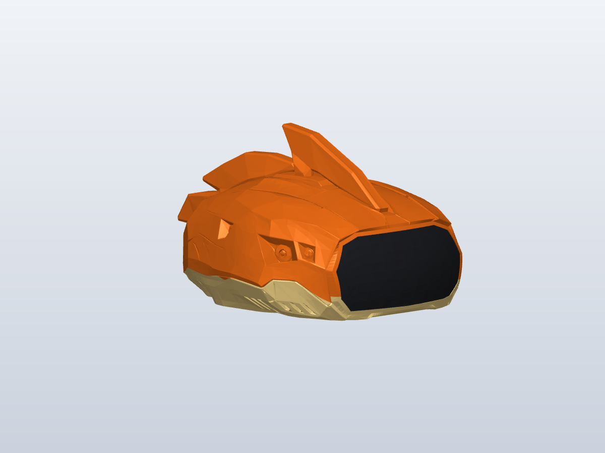

# head_v1

Xduck 头部外形与连接件装配版本，保存日期：2026-10-27。

主文件：[head_v1.solidcraft](head_v1.solidcraft)。文件内嵌三个外壳网格和 STEP 连接件数据，可直接用 SolidCraft 打开。

## 文件

| 文件 | 内容 |
|---|---|
| `head_v1.solidcraft` | SolidCraft 装配：橙色上壳、黄色底壳、黑色镜片和原连接件 |
| `head_v1.glb` | 三个独立外观网格，保留共同装配坐标；glTF 使用米制单位 |
| `parts/orange.stl`、`parts/yellow.stl`、`parts/black.stl` | 分件表面网格，坐标单位为毫米 |
| `parts/connector.step` | 原连接件的装配位置，凸起朝头内，底面为 Z=0 |
| `previews/` | 整体、正面边框、侧面开口与小坑补面的预览 |
| `validation.json` | 几何检查记录 |
| `SHA256SUMS.txt` | 版本文件校验和 |

## 本版状态

- 原始橙黄分界与颜色占比保留；上下和前后使用同一约 1.314 倍比例，左右宽度不变。
- 头部总高相对初始适配版增加 40 mm；含鳍片的整体外包尺寸约为前后 314.3 × 左右 242.8 × 高 167.4 mm。
- 黑色镜片为连续完整面，黄色眼睛已移除。
- 连接件保持原尺寸及孔位，凸起朝内；底壳收口采用斜面折回，开口周边间隙 0.25 mm。
- 前侧三道开口左右对称各三道，已检查黄色各层没有遮挡。
- 黄色镜片下沿重建连续边框和承接面，清理原有凸起与尖刺。
- 侧面小三角坑仅按三个口沿点补面；周围原始顶点未移动，未对整块侧面抹平。

这是外形与静态装配设计版本。外壳分件仍是表面网格，并非带完整参数化特征树的闭合打印实体；完整壁厚、紧固结构和运动校核尚未完成。连接件沿用输入 STEP 的开壳几何。

## 校验

在本目录运行 `shasum -a 256 -c SHA256SUMS.txt` 可核对本版文件。
