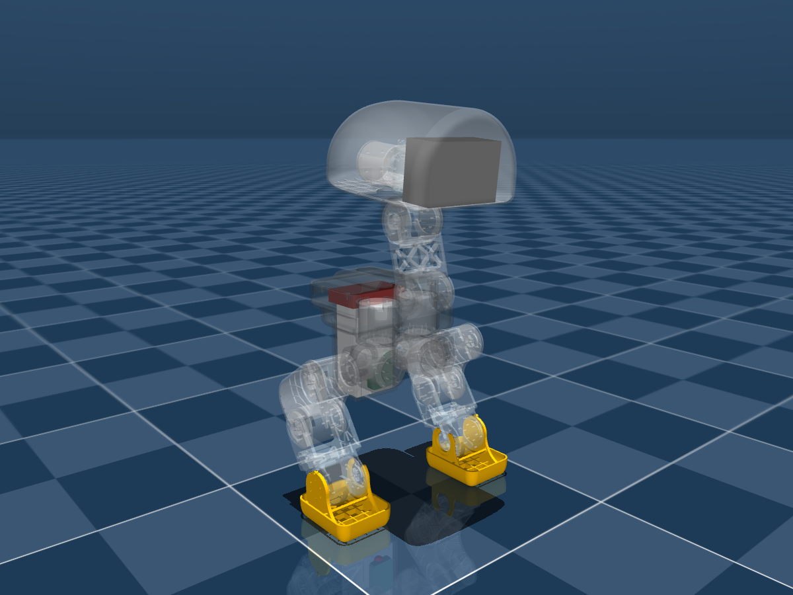

# xduck 1.1.2 MJCF

由本目录原始 `robot.urdf` 和 `meshes/` 构建，保留源文件不变。
模型入口为 `mjcf/scene.xml`；无地面机器人本体为 `mjcf/robot.xml`。
两者的 keyframe 0 都是重新求解的 **HOME**，14 个位置控制电机，整机质量 **8.8933 kg**。

## 相对 1.1.1 的迁移

- **全部 14 个关节轴向反转**；新轴向、关节范围和连杆变换直接读取 1.1.2 URDF。
  actuator 控制范围与各关节的新限位一致。电机顺序仍是左腿 5、头部 4、右腿 5。
  旧策略的关节数值、动作符号和 HOME 不能直接复用。
- **分线板**采用 `power-strip.stl` 及源 URDF 的 135g 质量、重心、完整惯量。
  按“正式分线板替代旧版电池顶 135g 占位负载”处理，不另加旧 `payload`。
  这是本次构建假设；若实际还存在独立的额外配重，需要增加后重算 HOME。
  新分线板包围盒约 62.44 × 99.81 × 20.00 mm，位置约 `(-0.10601, 0, -0.02210)` m，
  因此没有沿用旧占位盒的 50.1 × 70 × 20 mm 惯量。
- **每电机增益**延续用户指定的 1.1.1 调整，力矩上限统一 ±18 Nm：

  | 关节 | KP | KD |
  |---|---:|---:|
  | hip_yaw | 30 | 0.5 |
  | hip_roll | 70 | 3.5 |
  | hip_pitch | 60 | 1.5 |
  | knee_pitch | 55 | 0.9 |
  | ankle_pitch | 60 | 1.0 |
  | neck_pitch | 25 | 0.6 |
  | head_pitch | 10 | 0.2 |
  | head_yaw | 6 | 0.15 |
  | head_roll | 15 | 0.4 |

  延续 DM-J4340P 模型参数：damping=0.1、frictionloss=0.1、armature=0.032。
  2026-09-30 为全部 14 个电机关节各增加一个独立串联弹性坐标 `<电机关节名>_flex`；
  首轮统一假设机械刚度 75 N·m/rad、机械阻尼 1 N·m·s/rad；随后按用户要求做
  分关节静态站姿拟合，当前 XML 使用下表的候选刚度，阻尼仍全部为 1。
  它们不是原有伺服 kp/kv，也不是逐关节真机标定结果。仍保留 14 个原电机坐标和 14 个驱动通道，
  HOME 的新增弹性坐标初始化为零；站姿对齐诊断中约束电机编码器，负载侧自由受力。
  本候选尚未对齐 pitch：仿真约 +1.20°，真机截图约 −3.67°，仍差约 4.87°。
  单个静态姿态不能唯一辨识 14 个机械刚度；左右参数差异不是已证实的硬件差异。

  | 机械弹性坐标 | 候选刚度 N·m/rad |
  | --- | ---: |
  | 左/右髋偏航 | 600 / 600 |
  | 左/右髋侧摆 | 1000 / 1000 |
  | 左/右髋俯仰 | 5 / 1000 |
  | 左/右膝 | 1000 / 1000 |
  | 左/右踝 | 333.333333 / 1000 |
  | 颈部俯仰 | 4 |
  | 头部俯仰 | 25 |
  | 头部偏航/侧摆 | 75 / 75 |
  源 URDF 的 effort=10 / velocity=1 为导出字段；本模型按用户要求使用 ±18 Nm，
  没有增加 1 rad/s 的速度截断。无速度相关转矩曲线或热模型。
- **独立鞋底**继承 `sole_left/right.stl`，priority=1，保持 `left/right_foot_collision` 命名。
  实测尺寸约 108.13 × 84.44/84.71 × 2.80 mm，底面超出原脚底约 0.3 mm。
  原脚踝凸包保留为 `left/right_ankle_collision`。新旧脚踝网格顶点集合几何一致，
  尽管左脚 STL 文件的二进制哈希不同，因此可复用这两块鞋底。
- **IMU**在源 URDF 的安装位置上加 z=12 mm。2026-09-30 将 `base_link`
  坐标原点平移到现有 `imu` site；IMU body 的父坐标位置现在为 `(0, 0, 0)` m。
  对齐后又按用户要求将 IMU 安装位置向外（机身后侧，`-X`）移 10 mm、
  向下（`-Z`）移 10 mm；base_link 原点随 IMU 测量点一起移动。
  新原点相对最初原点的偏移是 `(-0.0912282642, 0, -0.1711002984)` m。
  同步补偿根节点的网格、惯量、直接子节点和 HOME 根位置，保持机器人原有世界几何；
  除 IMU 实体、测量点及其质量中心发生上述安装平移外，其余世界几何保持不变。
  base_link 坐标轴方向保持不变，未将其旋转为 IMU site 的坐标轴方向。
  visual、collision、imu site、红色 marker 共用 IMU body 变换。
- **惯量与接触**保留每个 URDF 固定连杆的独立 body 与惯量，21 个实体 body 加 world；
  不复用旧版已融合并舍入的惯量。旧版 base/hip_roll、head_pitch/head_roll 的装配凸包排除
  扩展到相应固定子零件，保持融合前后的排除语义。

## 新 HOME

先解静态鞋底平面，再求 CoM 对支撑中心的初始腿角；随后每轮仿真 8 秒，
以沉降后的基座 pitch 为误差求解腿部前倾角。hip_roll=0，膝关节保持 0.005 rad 的预弯。
积分器为 implicitfast，步长 2 ms；另以 1 ms 验证。

新 neck 限位是 `[-0.3, 1.3]` rad。旧 +20° 换向后为 −0.349066 rad，已越界，
所以 HOME 的 neck 改为 **−0.25 rad（−14.32°）**，给下限留 0.05 rad 控制目标余量；
head_pitch 保留同一物理方向的收头角，取 **−20°**。

| 参数 | 左 / 值 | 右 |
|---|---:|---:|
| 腿部前倾 α | 34.082097° | |
| hip_pitch (rad) | +0.594844817 | −0.594844817 |
| knee_pitch (rad) | +0.005 | −0.005 |
| ankle_pitch (rad) | −0.589848490 | +0.589848490 |
| base_z (m) | 0.31501343 | |
| neck_pitch (rad) | −0.25 | |
| head_pitch (rad) | −0.349065850 | |

精确 qpos、ctrl 与索引映射见 `mjcf/home_pose.npz` 和 `mjcf/home_pose_motor_targets.txt`。
新模型只发布已验收的 HOME；旧 INIT/STAND/SIT/FOLD 不作为新限位下的有效姿态迁入。

## 验收结果与边界

详见 [acceptance.md](mjcf/acceptance.md) 和 [build_report.json](mjcf/build_report.json)。

- 8 秒站立 pitch −0.000012°，30 秒 −0.010582°，均满足 |pitch| < 0.05°。
- 10 mm 初始落差、0.3 m/s 初始侧向速度、0.25 m/s 初始前向速度均恢复站立。
- 1 ms 步长复测 pitch −0.001814°；所有试验无数值警告、无非地面接触，未达到力矩上限。
- 独立使用 MuJoCo 原生 URDF 导入器校验零位、HOME 与 15 组限位内姿态，
  刚体变换、质量中心与惯量张量一致。这里的独立检查共用 MuJoCo 引擎，不是跨引擎验证。
- 8.5 cm 指鞋底**网格几何宽度**。受力沉降后鞋底会有轻微横滚，离散接触点并不铺满全宽；
  此现象也存在于 1.1.1。踝部凸包可能与鞋底一起接地。
  保留既有接触几何和增益，不把该几何宽度描述成完整压力分布的实测证据。
- 这些测试覆盖 HOME 附近的仿真稳定性；并未验收所有限位组合的实体干涉，
  源模型的凸包碰撞仍有装配相邻体排除。

## 使用与重建

macOS 可双击本目录 `Open_MuJoCo_Viewer.command`，暂停状态打开 HOME，空格开始仿真。
也可从仓库根目录运行：

```sh
mjpython mujoco_viewer.py robots/xduck/1.1.2/mjcf --keyframe 0 --paused
python3 tools/robots/xduck/build_v112.py
python3 tools/robots/xduck/build_v112.py --validate-only
python3 tools/robots/xduck/build_v112.py --validate-only --render
```

构建依赖：MuJoCo、NumPy、SciPy、trimesh；预览额外需要 Pillow 和 OpenGL。
本次使用 MuJoCo 3.3.7；构建报告保存输入和模型输出的 SHA-256。
专用脚本直接处理源 URDF、鞋底迁移与 HOME 沉降求解，不通过通用转换器覆盖最终包。
重建只写本版本 `mjcf/`，不会修改 1.1.1 或原始 URDF/meshes。


